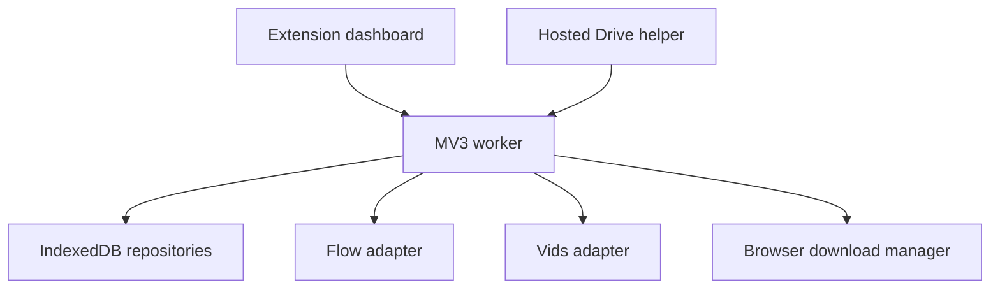

# Architecture

Status: P02.2 runtime foundation and P02.3 read-only target attachment are implemented at offline-verification level. P04.1 Flow prompt entry is verified offline/local-browser only; P04.2 durable one-image dispatch is verified offline and with local browser fixtures. Real Flow DOM compatibility and provider acceptance remain NOT_RUN; queue/workflow completion remains planned.

## Runtime surfaces

| Surface                  | Responsibility                                                                                                                                                                                                                                                                                                        |
| ------------------------ | --------------------------------------------------------------------------------------------------------------------------------------------------------------------------------------------------------------------------------------------------------------------------------------------------------------------- |
| Full-tab React dashboard | Batch input, previews, confirmations, image choices, progress, downloads                                                                                                                                                                                                                                              |
| MV3 service worker       | Validates extension-page messages, owns local draft/preference/selected-target metadata, marks selections unverified at startup, reconciles durable P04.2 image attempts without replay, and announces worker restarts to open dashboards. Scheduling, terminal result attribution, and downloads remain future work. |
| Flow content adapter     | Same-project editor/reference interaction, result attribution and observation                                                                                                                                                                                                                                         |
| Vids content adapter     | Same-document reference/prompt interaction and generated-result observation                                                                                                                                                                                                                                           |
| Hosted Vids helper       | Separate web OAuth/Picker context and whole-document Drive MP4 preparation                                                                                                                                                                                                                                            |
| Local Node companion     | Split an existing MP4 from explicit measured scene boundaries using FFmpeg/ffprobe                                                                                                                                                                                                                                    |

The local splitter is an explicit external step after the combined MP4 and boundary manifest exist. A Chrome extension cannot be assumed to execute a local Node/FFmpeg program directly. Native messaging is not part of the initial architecture.

## Proposed source map

| Directory/file                                  | Purpose                                                             |
| ----------------------------------------------- | ------------------------------------------------------------------- |
| src/app/App.tsx                                 | Compose screens, without owning provider algorithms                 |
| src/app/styles/tokens.css, globals.css          | Semantic theme tokens and common layout                             |
| src/app/components/                             | Shared controls and notices                                         |
| src/app/components/ConnectionStatus.tsx         | Explicit tab/project connection UI                                  |
| src/platforms/shared/connection.ts              | Route validation and no-refresh selected-target handshake           |
| src/platforms/shared/chromeConnectionPort.ts    | Optional permission checks and document-bound Chrome APIs           |
| src/platforms/shared/connectionProbe.ts         | Packaged read-only isolated-world connector                         |
| src/app/features/image-batch/                   | Image JSON import and queue view                                    |
| src/app/features/references/                    | Selected image review and shot labels                               |
| src/app/features/video-batch/                   | Video JSON pairing and destination selection                        |
| src/app/features/downloads/                     | Exact download progress and split handoff                           |
| src/domain/batches/                             | Pure lossless import and identity rules                             |
| src/domain/jobs/                                | Pure state transitions and advancement rules                        |
| src/domain/media/                               | References, scene boundaries and media evidence                     |
| src/background/index.ts                         | Listener registration only                                          |
| src/background/handlers/                        | Validated message orchestration                                     |
| src/background/generationQueue.ts               | One active generation attempt for the active provider               |
| src/background/downloadManager.ts               | Exact browser download ID tracking                                  |
| src/platforms/shared/contracts.ts               | Provider interfaces and fixed result categories                     |
| src/platforms/shared/connectionLifecycle.ts     | Worker-restart invalidation for transient connection state          |
| src/platforms/flow/                             | Flow connection/composer/images/observer/references/video/downloads |
| src/platforms/vids/                             | Vids connection/composer/references/video/observer                  |
| src/storage/db.ts, repositories.ts              | Durable typed records and transactions                              |
| src/shared/messages.ts, schemas.ts              | Message envelopes and runtime validation                            |
| src/shared/buildInfo.ts                         | Shared dashboard/worker/content build identity source               |
| external/vids-helper/                           | Adapted hosted helper, kept outside extension bundled runtime       |
| tools/local-mp4-splitter/                       | Adapted native companion, separate from browser code                |
| tests/unit/, tests/integration/, tests/browser/ | Targeted verification layers                                        |

These are planned paths. Their presence in this document does not mean they already exist.

P02.2 packages the existing dashboard, an MV3 module worker, and the standalone connector asset. P02.3 upgrades that asset into a read-only Flow/Vids top-frame connector with route, project, protocol, build, capability, and document-token checks. The connector exposes no generation capability. Offline mocks establish the extension's decisions and safe failure behavior; they do not establish that current live provider routes or document behavior match the supported rules.

P02.3 selection requires an explicit tab choice per provider. One strict shared route parser is used by discovery and the standalone injected connector. Supported Flow routes include `/fx/tools/flow/{projectId}`, `/project/{projectId}`, and the account-prefixed `/u/{accountIndex}/project/{projectId}` form; Vids accepts `/video/{documentId}/edit` and `/videos/d/{documentId}/edit` on its recorded hosts. The Flow account index is route data, not an email or permanent account identity. It remains part of the canonical target, and the original tab URL is retained and never rewritten. No account is selected or switched automatically. Tab-listing access (`tabs`) is requested only from Find open projects; Connect inspects `scripting` and the selected provider host permission before requesting only missing grants. Permission state is independent of Connected state.

## P04.1 Flow prompt entry boundary

`src/platforms/flow/composer.ts` performs bounded semantic discovery in the selected top-frame document. Search controls are excluded. A single visible, enabled editor must belong to a labelled composer/form/group/region or an explicit composer owner. Placeholder text is only a corroborating candidate signal. These attributes are selector candidates; actual Flow DOM evidence remains NOT_RUN.

`src/platforms/flow/promptEntry.ts` validates a single current image JSON body, revalidates the stored explicit Flow target and current tab URL, checks the top-frame loader identity, and sends text only through CDP `Input.insertText`. The editor must be an empty textarea/text input or already contain the exact full string. Different nonempty text is left untouched. Contenteditable discovery is reported unsupported because its exact insertion/readback contract has not been demonstrated. No fallback input method runs after failure or uncertain delivery. Exact string comparison is followed by bounded three-sample stability readback; diagnostics expose lengths, safe hashes, first mismatch offset/category, and binding replacement state without prompt excerpts. The endpoint never activates submit or Generate, and always reports generation unavailable.

P04.1 requires Chrome's `debugger` permission as a required manifest permission because debugger access cannot be requested as an optional permission. It is not in `optional_permissions`. The permission is used only after the user invokes the explicit image fill control; selected tab/project and top-frame URL/loader are rechecked before and after asynchronous stages. The dashboard requires the user's existing manual Flow settings confirmation and exposes no Generate action. Local fixture evidence does not establish a compatible Flow framework editor.

## P04.2 durable one-image Generate attempt

The dashboard enables **Generate once in Flow** only for one current validated image prompt that exactly matches its saved source and a manual settings attestation bound to the stored selected Flow tab/project. The attestation includes the canonical target so a changed account-prefixed route cannot reuse a prior confirmation on the same tab/project ID. The worker reloads and validates the saved `(workspaceId, image)` repository snapshot, verifies the prompt hash and measured lengths, checks the current Flow route and top-frame identity, and stores a durable attempt before prompt entry. Because batch replacement reuses mutable batch/item IDs, the worker also creates or reuses a write-once prompt snapshot keyed by item ID and SHA-256. The attempt stores that `sourceSnapshotId`, not a raw prompt body. Snapshot retrieval rechecks identity, exact body, hash and measurements; a missing or mismatched snapshot fails closed. Later saves do not mutate the referenced source. The new attempt's canonical-target attestation field is optional when reading historical records, avoiding a storage migration.

After exact settled prompt readback, the worker requires one semantic composer, one enabled Generate control and a ready results baseline, then rechecks the prompt, target/frame, button and baseline. The baseline accepts either the prior unique visible exact-labelled results surface or the evidence-backed empty UI profile: one visible `Start creating or drop media` marker in the observed `flow-project-page` structure that also owns the verified composer, with no visible result/card/media or loading conflict and a stable two-frame observation. Nested phrase matches for the same marker are deduplicated by marker element ownership; independent markers, wrong project/composer ownership, hidden markers, loading, conflicts, or mutation remain blocked. This is evidence of the selected workspace's empty UI, not proof that the provider project database is empty. Hidden media is ignored and unverified visible media/card structures block as unsupported; they are not classified as generated results. The worker persists `dispatch-intent` before sending a single CDP mouse press/release pair. A `dispatched` record means the input pair was sent, not that Flow accepted it or produced a result. Unsupported post-dispatch observations remain unknown and do not trigger another activation. Uncertain input is retained and not replayed. A durable unique active-item key blocks another active attempt; a unique settings-confirmation key blocks duplicate requests. Startup reconciliation marks `preparing`/`verified` attempts failed before dispatch and `dispatch-intent` attempts uncertain. Offline tests cover these repository state changes; actual MV3 service-worker suspension/restart is not browser-verified. Terminal result attribution remains later scope. Focused local browser fixtures exercise the attempt handler against synthetic DOM and an in-memory repository; they do not access a provider tab.

Connect first pings frame 0, reuses a matching connector, and injects the packaged connector only if absent or stale. An injected connector instance keeps its exact listener reference; known stale listeners are removed before replacement. An older unmanaged probe with no listener reference is left alone and reported as stale instead of being duplicated. `scripting.executeScript` supplies the browser `documentId`; the final message is addressed to that `documentId` and frame 0, and the project URL is checked again before and after the handshake. The response must include `read-only-connection-v1`; additional capability strings are tolerated for protocol compatibility but are not granted by the read-only connection result. Safe mismatch diagnostics report field states only, never identifier values. A worker-start event, a supported route change, or a same-tab document load invalidates displayed Connected state and requires a fresh handshake; manual Disconnect remains authoritative. Selected-target records remain unverified metadata; connection status is ephemeral and grants no generation capability.

## Ownership and persistence

- IndexedDB holds batches, immutable prompt bodies, shots, selected image bytes/metadata, attempts and result associations.
- Extension storage holds small preferences/configuration/build metadata where appropriate.
- No content-script global or React state is authoritative queue storage.
- Do not put full images and repeated JSON history in small settings records.
- One repository transaction records the relevant state change and identity binding.
- Service-worker startup restores records, reconciles observed state, and resumes observation when possible, without replaying Generate.

Current P02.2 storage boundaries:

- `src/storage/db.ts` owns the fresh `automat-faceless-app-v1` Dexie/IndexedDB namespace and defines foundation tables for prompt drafts, selected target metadata, workflows, and draft batches.
- `src/storage/repositories.ts` is imported by the extension worker, not by provider content scripts. Writes use Dexie transactions. The worker marks persisted selected targets `unverified` when its context starts; only a later fresh provider handshake may mark a matching target verified.
- Chrome `storage.local` holds the small theme preference. Raw prompt draft text stays in IndexedDB and passes through the repository as an unchanged string.
- No workflow queue, provider generation, or automatic recovery state is implemented here. Operations are short one-shot messages; worker memory is not authoritative for saved data.

## Command boundaries

Each P02.2 dashboard-to-worker message carries protocol version, build ID, request ID, an explicit operation type, and a Zod-validated payload. The worker accepts only messages from its own extension dashboard page. This phase uses `runtime.sendMessage` with the callback response channel (`return true`) for async work; it does not hold a long-lived `Port`. Operation-specific client deadlines are bounded, and error categories distinguish invalid requests, sender rejection, protocol/build mismatch, duplicate request, missing data, storage failure, missing worker, malformed response, and timeout. Timed-out callers ignore late responses; storage writes upsert by stable draft/target key, so a retry after worker termination does not create a duplicate record.

Future workflow commands should also carry batch/item/attempt identity, provider, tab ID, canonical project/document ID, and expected adapter capability where applicable.

Commands are short operations. Generation observation is event/status work, not a promise that must remain open for the entire video generation. Return an accepted result after durable state exists.

Avoid queue self-deadlocks: a content adapter's direct text-input request must not enqueue behind an outer operation that is awaiting that same response. Separate command serialization from observation updates.

## Dispatch and completion

1. Revalidate the target binding and current item.
2. Enter the exact prompt and verify settled readback.
3. Persist a new attempt and pre-dispatch result baseline.
4. Complete fresh preflight.
5. Observe before dispatch where the provider interaction requires it.
6. Activate Generate once; preserve input delivery evidence.
7. Observe only attributable results from this attempt.
8. Persist and read back terminal completion.
9. Schedule the next eligible item.

The exact adapter order must respect the real provider UI; this sequence describes evidence boundaries, not an invented stable DOM contract.

## Settings and provider routing

Settings confirmation is a user attestation bound to the selected target/context. Record declared variant count and optionally duration/model/ratio for tracking. Do not silently change settings or infer that attestation equals machine observation.

A video batch snapshots its selected provider. Changing the selector affects a new/unstarted batch, not an in-flight job.

Flow image and Flow video are distinct capabilities; do not assume an image Generate resolver is valid in video mode.

## Result attribution

New loaded media alone is insufficient if it may be an older lazy-loaded card. Retain attempt baseline, stable media evidence, processing/error state and project binding. If the available live provider contract cannot establish attribution, pause that attempt for review and report the missing evidence.

P05.1 implements only the pre-dispatch baseline contract. The attempt stores a validated `resultBaseline` alongside the P04 UI baseline before durable `dispatch-intent`, bound to the exact workspace/batch/item/source hash/snapshot/attempt and selected Flow project/tab/frame/loader/build/protocol. The existing P04 empty-workspace profile is recorded as a complete observation of that selected UI scope only. The supported labelled-results profile remains incomplete until stable result identities and card ownership are established; its media count is inventory metadata, not a result count. Baseline equality and document binding are rechecked before activation. Stable provider-issued result, asset, or group/variant IDs are the only identity forms in the contract; positional order, DOM node identity, thumbnail URL, image count and appearance time cannot prove ownership. Without explicit attempt/snapshot attribution evidence, a new stable identity is only a candidate. Missing identity or incomplete baseline remains ambiguous/excluded. No current populated Flow result selector or identity format is claimed live-compatible, and no terminal completion, observer messaging, queue advancement or lock release is implemented in P05.1.

Manual favourite selection stays independent of generation completion. A completed image job can have no favourite selected yet.

## Download separation

- Generation completion produces a provider result reference.
- Download preparation produces a validated transport and filename.
- Browser download completion is tracked using the exact download ID.
- Local decoded-media verification is a separate fact.
- Vids Drive preparation downloads the whole edited document, not automatically each sidebar result.
- OAuth account/file grants in the hosted helper are separate from Chrome Identity grants; do not assume continuity.

## External/local boundaries

The hosted helper communicates only through a narrowly bound prepared-download handoff to the intended extension build/project. Keep account tokens out of the extension handoff.

The splitter receives a local MP4 and measured boundary manifest. If a future native bridge is requested, design and authorize it as a later change, not an invisible dependency.
