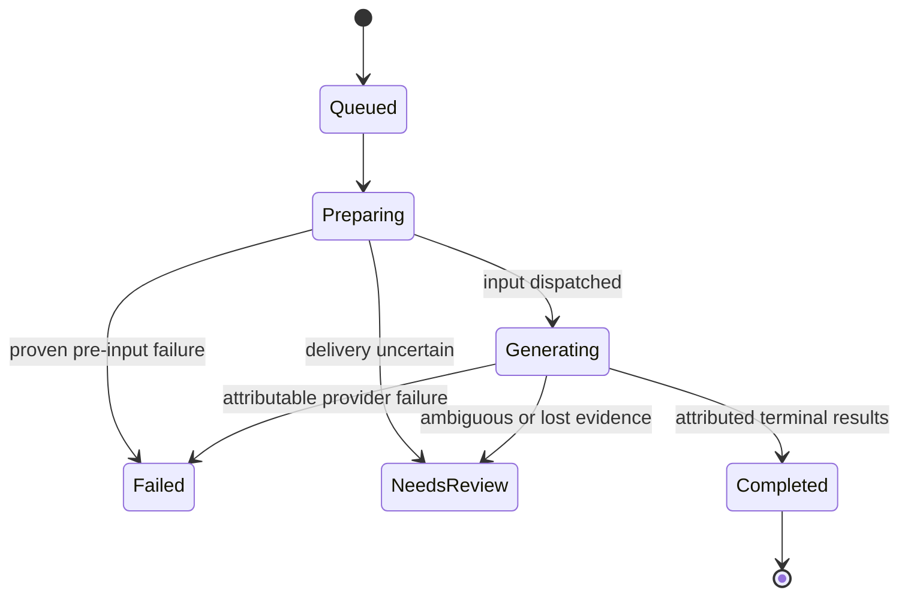

# Data Model and Identity

Workflow/domain records remain proposed. P02.2 established the initial extension-owned persistence boundary; P03.4 adds validated imported-batch persistence as described below.

## Core records

| Record               | Essential fields                                                                                          | Ownership            |
| -------------------- | --------------------------------------------------------------------------------------------------------- | -------------------- |
| Workflow             | workspaceId, name, linked image/video batch IDs                                                           | Repository           |
| Batch                | batchId, workspaceId, kind=image/video, selectedProvider, orderedItemIds, status, createdAt               | Repository/worker    |
| PromptItem           | itemId, batchId, shotId, rawJsonBody, sourceSpan, UTF-8 size, string length, hash                         | Importer/repository  |
| Shot                 | shotId within workspace, imagePromptItemId, selectedReferenceId, videoPromptItemId                        | Domain               |
| SelectedReference    | referenceId, shotId, origin provider/project, media identity, blob key, mime/dimensions, preview metadata | Reference repository |
| SettingsConfirmation | confirmationId, provider, target binding, mode, declared fields, confirmedAt                              | User attestation     |
| Attempt              | attemptId, itemId, provider/project/tab binding, stage, dispatch evidence, timestamps, fixed reason       | Worker               |
| Result               | resultId, attemptId, provider media identity, terminal evidence, output index                             | Provider/repository  |
| Download             | downloadRecordId, resultId or Vids documentId, exact browserDownloadId, filename, status                  | Download manager     |
| CombinedExport       | documentId, export operation identity, whole-document acknowledgement, downloadRecordId                   | Vids helper/worker   |
| SceneBoundary        | clipId, shotId where established, name, start/end presentation times, provenance                          | Manifest builder     |
| SplitVerification    | source identity, clip path/name, expected/observed frames and duration, audio check                       | Local companion      |

Extension-owned records in `automat-faceless-app-v1` (current Dexie schema version 5):

- `PromptDraftRecord`: stable draft ID, `kind` (`image` or `video`), exact `rawText`, and update time. Storage does not parse, stringify, normalize line endings, or apply an inherited 12,000-character limit. Synthetic offline fixtures test transport and repository-boundary preservation; this does not establish provider prompt limits or unlimited transport capacity.
- `SelectedTargetRecord`: provider, browser tab ID, canonical target key, update time, and `verification`. A newly stored selection is `unverified`; worker startup marks every saved target unverified. P02.3 keeps the persisted value as selection metadata; the UI's ephemeral Connected status is never persisted as proof. No offline mock result calls the repository verification operation.
- `PromptBatchRecord`: one saved imported source per `(workspaceId, kind)`, with exact `sourceText`, input mode, ordered item IDs, total measurements, and update time. P03.4 stores image and video batches independently and scopes them to a workspace. The current import screen uses the explicit local workspace ID `default` until workflow selection exists.
- `PromptItemRecord`: deterministic item ID, batch/workspace/kind, order, canonical `shotId` and identity source when present, exact `rawJsonBody`, JavaScript `sourceSpan`, UTF-16 code-unit and UTF-8 byte measurements, SHA-256 content hash, and creation time. The hash is a supplemental integrity check; exact string equality remains required.
- `FlowImageAttemptRecord` (Dexie v4): durable one-image attempt ID and state, a unique active-item key while the attempt can still dispatch or has dispatched, a unique settings-confirmation key for repeated-click protection, workspace/batch/item/shot identity, exact-source SHA-256 and code-unit/UTF-8 measurements, Flow project/tab/top-frame/loader/build/protocol binding, user-attested settings confirmation including canonical target, pre-dispatch labelled-results baseline, bounded fixed-code stage events, and timestamps. The canonical-target field is optional when reading older records and present on new attempts; no storage migration is required. It stores no raw prompt body. States are `preparing`, `verified`, `dispatch-intent`, `dispatched`, `failed-before-dispatch`, and `uncertain`. Startup reconciliation fails pre-dispatch states closed and converts a durable dispatch intent to `uncertain`; it never replays Generate. Offline repository tests cover transitions and reconciliation, not actual browser worker suspension.
- `FlowImagePromptSnapshotRecord` (Dexie v5): a write-once, content-addressed snapshot of the exact image prompt body referenced by an attempt. Its key derives from item ID and SHA-256; identity, code-unit length, UTF-8 byte count, and hash are validated on insert/read. A later `savePromptBatch` may replace mutable latest batch/item rows but has no update/delete path for these snapshots. Identical content for the same item reuses its snapshot; a changed body creates a different key. The attempt references `sourceSnapshotId` instead of copying the body into attempt history. Missing/corrupt/mismatched snapshots block dispatch. The integration regression replaces the latest batch after attempt creation and verifies that the attempt still resolves the original source.
- Prompt batch replacement stores the batch and its items in one IndexedDB read/write transaction. The additive schema upgrade adds the prompt item table without clearing existing draft, target, workflow, or batch tables. Saved records are reparsed and compared with their original source at readback.
- `WorkflowRecord` and generation queue state remain minimal/not implemented. P03.4 persistence stores imported prompt batches only; it does not authorize provider actions.
- Theme is a small preference in Chrome `storage.local`; prompt bodies and other larger app data do not go into Chrome Storage.

## Identity rules

- App-owned stable IDs are not provider card indexes.
- Shot 01 retains its identity when a row is sorted, an image is reselected, or the dashboard reloads.
- Each selected image is explicitly assigned to a shot. Selecting the second visible card does not mean Shot 02.
- Changing an image before a video batch starts updates that shot's explicit selection. An executing batch retains its snapshot.
- A hash helps detect content changes; a hash alone is not a provider result association.
- Persist raw prompt content separately from derived preview/diagnostics.
- Persist raw text only in the extension-owned IndexedDB namespace. Provider content scripts do not import the database module and must not use the provider page's IndexedDB for extension records.
- A missing image or video prompt blocks that pair with a clear row-level message; do not shift the remaining pairs.
- Duplicate shot IDs are import errors.
- Record user-attested associations as user-attested, not machine-proven.

## State model

Keep user status simple while retaining attempt detail.

DispatchIntent is a durable attempt stage written before input. Persist it before the transition to Generating. On restart, unfinished intent with no conclusive delivery evidence becomes NeedsReview; it never resets to Queued automatically.

Downloads have a separate state progression. A generated item can be completed while its download is pending, failed or interrupted.

## Pairing

Join on explicit (workspaceId, canonical shotId) within an explicit image-batch/video-batch linkage. Different episodes/workspaces can each have Shot 01 without cross-pairing. Require exactly one selected reference and one video prompt per runnable shot. Show missing, duplicate and unused items before Start.

Never pair by raw array index after filtering, current selection, lexical filename sorting, or whatever reference was last captured.

## Settings

Store declared user selections only as metadata/attestation. Do not use a duration formula. Do not confuse expected generation duration with actual downloaded-media duration.

Confirmations are tied to a target/provider context and can be invalidated by target/context changes. They are not a continuous machine setting monitor.

## Persistence and migration

Use a fresh database namespace for the new build. Version app-owned schemas. Validate at storage/message boundaries.

The legacy archive is reference material. Do not import unknown attempts, settlement archives or locks into the new runtime by default. OAuth registered IDs and helper handoff identity need deliberate configuration when the extension ID changes.

Within the new runtime, active attempts cannot be silently deleted/replayed. Queued unsent data and executed history have different lifecycle rules.
